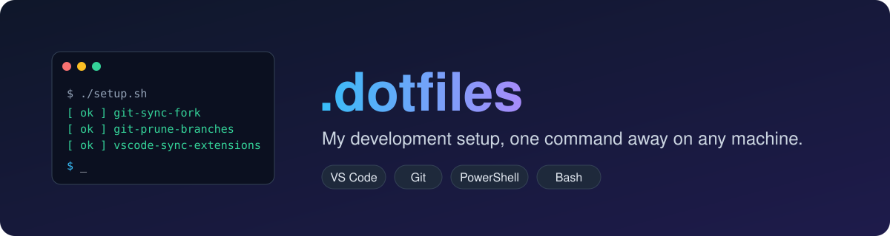
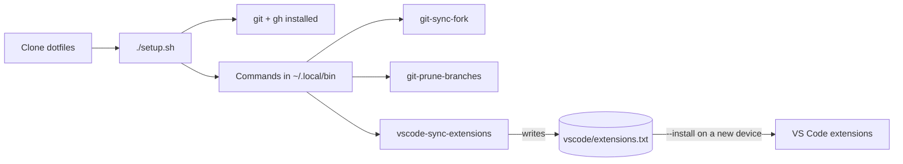

<div align="center">



<br>


[](LICENSE)

**Settings, scripts and commands I rely on every day, kept in one place so a new machine feels like home in minutes.**

[Quick start](#-quick-start) · [What's inside](#-whats-inside) · [Commands](#-commands) · [How it works](#-how-it-works) · [Usage](#-usage)

</div>

---

## ⚡ Quick start

```sh
git clone https://github.com/sleepinzombie/dotfiles.git
cd dotfiles
./setup.sh          # Windows (PowerShell): ./setup.ps1
```

That installs `git` and the GitHub CLI, signs you in to `gh`, and puts the commands below on your `PATH`. It is safe to re-run, and `--dry-run` previews everything first.

## 📦 What's inside

| | Area | What you get |
| --- | --- | --- |
| 🧩 | [VS Code](vscode/README.md) | Settings, fonts and an auto-synced extensions list |
| 🌿 | [Git](git/README.md) | Per-repo identity setup, fork syncing and safe branch pruning |
| 🪟 | [Windows SSH](powershell/setup-github-ssh/README.md) | GitHub SSH access and commit signing bootstrap |

## 🛠 Commands

Installed into `~/.local/bin` by the setup script:

| Command | What it does |
| --- | --- |
| `git-sync-fork` | Fast-forward your fork with its upstream, run from inside the fork |
| `git-prune-branches` | Delete merged or orphaned local branches, with recoverable backups |
| `vscode-sync-extensions` | Keep `vscode/extensions.txt` in sync with the extensions you have installed |
| `vscode-sync-settings` | Back up your VS Code `settings.json` into `vscode/settings.json` |

## 🔍 How it works



---

## 📖 Usage

### 1. Bootstrap the machine

Installs `git` and the GitHub CLI (`gh`), signs you in to `gh` if needed, and copies the `git-sync-fork` and `git-prune-branches` commands from this checkout into `~/.local/bin`, along with `vscode-sync-extensions` and `vscode-sync-settings` wrappers that run the scripts in this checkout. It is safe to re-run.

| Platform | Command |
| --- | --- |
| macOS / Linux / Git Bash | `./setup.sh` |
| Windows (PowerShell) | `./setup.ps1` |

Pass `--dry-run` (`-DryRun` for PowerShell) to preview without changing anything. The preview reports whether each command is missing, out of date, or already up to date. Supported package managers: Homebrew, apt, dnf, pacman and winget.

### 2. Update installed commands

After updating this dotfiles checkout, rerun the setup command above to copy its latest scripts into `~/.local/bin`. Use its dry-run option first to see which commands are missing or out of date; setup reports commands that are already up to date too. This updates the installed commands without changing your other project checkouts.

### 3. Sync a fork

From inside any cloned fork:

```
git-sync-fork              # sync the fork on GitHub with its upstream
git-sync-fork --pull       # ...then update the local default branch
git-sync-fork --checkout   # ...switch to the default branch first (implies --pull)
```

See [Git Settings & Configurations](git/README.md#sync-a-fork-with-its-upstream) for details.

### 4. Prune stale local branches

From inside any Git repository, preview branches that can be safely deleted:

```
git-prune-branches --dry-run
```

By default, the script asks for confirmation before deleting branches and backs up each branch tip locally. See [Git Settings & Configurations](git/README.md#prune-stale-local-branches) for detection rules, safety options, and backup recovery.

### 5. Sync VS Code extensions

From any directory, update `vscode/extensions.txt` from the extensions installed in VS Code:

```
vscode-sync-extensions --dry-run   # preview the changes
vscode-sync-extensions             # update extensions.txt
```

See [VS Code Extensions and Settings](vscode/README.md#sync-extensions) for all options, including installing on a new device.

To back up your VS Code `settings.json` the same way (manual, one-way, never committed for you):

```
vscode-sync-settings --dry-run   # preview the changes
vscode-sync-settings             # update vscode/settings.json
```

See [Back up settings](vscode/README.md#-back-up-settings) for all options.
